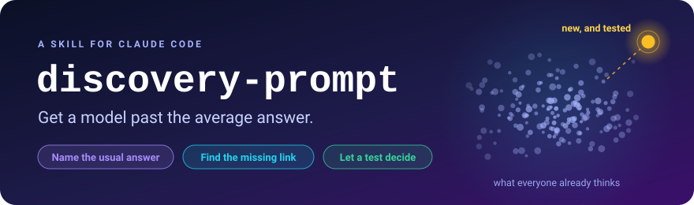
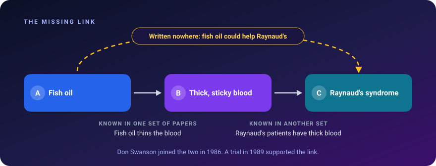
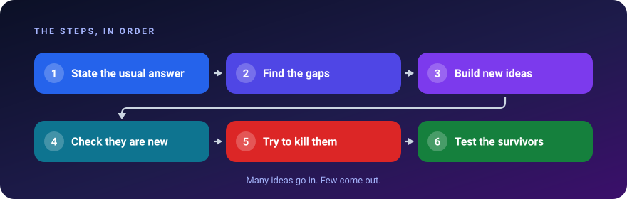

<div align="center">



**[How it works](#-how-it-works)** &nbsp;·&nbsp; **[How to use it](#-how-to-use-it)** &nbsp;·&nbsp; **[Install](#-install)** &nbsp;·&nbsp; **[How it was tested](#-how-it-was-tested)**

</div>

<br>

Ask a model a question and you get what most informed people already think. That is useful, but it is not new.

This skill writes the prompt that makes the model **look elsewhere**, and then makes it **prove what it found**.

## 🧭 How it works

Every prompt the skill writes makes three moves:

| | The move | Why it matters |
| :-: | --- | --- |
| 1️⃣ | **Name the usual answer and set it aside** | A model cannot move away from an average it has not stated. |
| 2️⃣ | **Build ideas from the gaps** | The best gap is a missing link: two known facts that nobody has joined. |
| 3️⃣ | **Let a test decide** | The test is fixed before anyone looks at a result. Most new ideas are wrong, so "nothing held up" is an accepted answer. |

<br>



One source shows that **A leads to B**. Another shows that **B leads to C**. Nobody has said that **A leads to C**. A model has read both halves of many such pairs, and it will not join them unless it is asked.

<br>



## 🚀 How to use it

Open a new session in your project's folder and ask in plain words. The skill picks the size from what you ask. You can also type `/discovery-prompt` followed by your request.

### 💬 One question

You want a less average answer to a single question.

```text
Give me a paragraph to add to my question so I don't get the usual answer.
```

**You get** one paragraph to paste after any question.

### 🔎 Your project

You want new ideas about a project that has a history.

```text
Write me a prompt that finds something we have not thought of about X.
```

**You get** one prompt, fitted to the project's rules and its record of what was tried.

### 💡 Just the ideas

You want the answer, not a prompt.

```text
Don't write a prompt. Tell me what we haven't thought of about X.
```

**You get** at most three ideas, each with a check that could kill it.

### 🌙 A long run

You want an agent to work alone for hours.

```text
Set up an overnight /goal run that finds X.
```

**You get** a brief saved in your project, and one line to paste to start the run.

> [!TIP]
> In a project, the skill reads your rules first and your record of past tries second. That is how it avoids sending the model back to ideas you already tested.

## 🧬 The long run breeds ideas

The long run works like a genetic algorithm.

| | Stage | What happens |
| :-: | --- | --- |
| 🌱 | **Seed** | Several agents invent ideas separately. Half of them never see what you tried, so they are not pulled toward it. |
| 🏆 | **Select** | The best ideas of each kind are kept, plus one unlikely idea drawn by lot. |
| 🔀 | **Breed** | The survivors are changed and crossed to make new ideas, for as many rounds as the time allows. |
| 🎯 | **Test** | The real test comes last, on a few ideas. |

> [!IMPORTANT]
> Ideas are never chosen by their test result. They are chosen by their sources, by whether a test could settle them at all, and by a critic that wrote none of them. An idea picked because it scored well on past data tends to do worse on new data.

## 📦 Install

```bash
git clone https://github.com/chrisduvillard/discovery-prompt ~/.claude/skills/discovery-prompt
```

Then start a new Claude Code session.

## 🚧 What it cannot do

> [!WARNING]
> A prompt changes **how** a model searches, not **what** it knows. The biggest step away from the usual answer comes from what the average document does not contain: your own data, your own observations, and a way to run the test.

## 🧪 How it was tested

Five kinds of request were run with the skill and, for four of them, without it. Each reply was checked against a list of what the method requires.

| | Checks passed | |
| --- | :-: | --- |
| **With the skill** | **72 of 72** | 🟩🟩🟩🟩🟩🟩🟩🟩🟩🟩 |
| **Without it** | 37 of 58 | 🟩🟩🟩🟩🟩🟩⬜⬜⬜⬜ |

In a separate trial, one question was asked with and without the skill's paragraph. The plain answer was the standard list. The other gave five views, each with what would prove it wrong, and three of them were absent from the plain answer.

> [!NOTE]
> These tests show that the method is followed. They do not show that the ideas are true, or better on a real project. Only your own test can show that.

## 📁 What is in this repository

| File | What it holds |
| --- | --- |
| `SKILL.md` | The method and the steps the skill follows |
| `references/blocks.md` | The paragraph, the five-step prompt, and the prompts for breeding ideas |
| `references/long-run.md` | How to write the brief and the starting line for a long run |
| `evals/` | The test cases |
| `assets/` | The images on this page |
